  

<h3 align="center">Full Stack Developer · Software Architect · Multi-Agent Systems Researcher 🇪🇸</h3>

  Diseño sistemas robustos, arquitectura limpia y orquesto agentes autónomos que colaboran para resolver problemas complejos 🚀

## 🧠 Sobre mí

Soy un desarrollador e investigador enfocado en la intersección entre **arquitectura de software distribuida** y **sistemas multiagente con IA**. Creo que el futuro del software pasa por agentes autónomos que se coordinan, se corrigen entre sí y escalan de forma inteligente.

## 🔭 En qué estoy trabajando

<table>
  <tr>
    <td width="50%" valign="top">
      <b>🏢 Aplicación empresarial compleja</b>  
      Con Spring Boot, microservicios, CI/CD y seguridad de alto nivel.
    </td>
    <td width="50%" valign="top">
      <b>🕸️ Framework de orquestación multiagente</b>  
      Diseño de sistemas donde múltiples agentes de IA colaboran bajo patrones de coordinación (supervisor, consenso, voting, debate).
    </td>
  </tr>
  <tr>
    <td width="50%" valign="top">
      <b>⚙️ Worker Systems con IA</b>  
      Pipelines de procesamiento distribuido donde workers autónomos ejecutan, validan y refinan tareas en paralelo con retroalimentación en bucle.
    </td>
    <td width="50%" valign="top">
      <b>🌐 Investigación en IOA (Internet of Agents)</b>  
      Exploración de protocolos de comunicación inter-agente, descubrimiento dinámico de capacidades y composición automática de flujos de trabajo.
    </td>
  </tr>
</table>

## 🤖 Mi visión sobre sistemas multiagente

  

> Diseño arquitecturas donde los agentes no solo ejecutan — **razonan, debaten, validan y se auto-corrigen** antes de entregar resultados. La clave está en patrones de orquestación que combinan lo mejor de la ingeniería de software distribuida con la inteligencia emergente de LLMs.

## 🌱 Áreas de especialización e investigación

| Dominio | Tecnologías & Conceptos |
|---|---|
| **Backend & Arquitectura** | Java, Spring Boot, Microservicios, DDD, CQRS, Event Sourcing |
| **Frontend Moderno** | Angular, React, Node.js, TypeScript |
| **Multi-Agent Systems** | LangGraph, CrewAI, AutoGen, Swarm, Agent Protocol |
| **Worker & Task Orchestration** | Celery, Temporal, Bull, sistemas de colas distribuidas |
| **IOA & Agent Communication** | A2A Protocol (Google), MCP (Anthropic), tool-use patterns, agent registries |
| **LLM Engineering** | Prompt engineering, RAG, function calling, chain-of-thought, self-reflection loops |
| **Seguridad & Observabilidad** | OAuth2, JWT, mTLS, OpenTelemetry, guardrails para agentes |
| **Infra & CI/CD** | Docker, Kubernetes, GitHub Actions, Terraform |

## 🔬 Líneas de investigación activas

- **Orquestación jerárquica vs. enjambre** — cuándo usar un supervisor centralizado vs. coordinación peer-to-peer entre agentes.
- **Self-healing agent workflows** — sistemas que detectan fallos, replanifican y reasignan tareas automáticamente.
- **Agent memory & context sharing** — gestión eficiente de memoria compartida y contexto entre workers de larga ejecución.
- **Human-in-the-loop patterns** — diseño de puntos de intervención humana en pipelines autónomos sin romper el flujo.
- **Evaluación y benchmarking de agentes** — métricas para medir fiabilidad, coste, latencia y calidad de sistemas multiagente.

## 🧰 Stack

**IDEs**

   

**Lenguajes**

     

**Frameworks y librerías**

       

**Bases de datos**

     ![IBM Db2](https://img.shields.io/badge/IBM%20Db2-161B22?style=for-the-badge&logo=data%3Aimage%2Fsvg%2Bxml%3Bbase64%2CPHN2ZyBmaWxsPSIjNkVBNkZGIiByb2xlPSJpbWciIHZpZXdCb3g9IjAgMCAyNCAyNCIgeG1sbnM9Imh0dHA6Ly93d3cudzMub3JnLzIwMDAvc3ZnIj48dGl0bGU%2BSUJNPC90aXRsZT48cGF0aCBkPSJNMjMuNTQ0IDE1Ljk5M2MuMDM4IDAgLjA2LS4wMTcuMDYtLjA1M3YtLjAzNmMwLS4wMzUtLjAyMi0uMDUyLS4wNi0uMDUyaC0uMDl2LjE0em0tLjA5LjI2MmgtLjEyMXYtLjQ5OGguMjI1Yy4xMTIgMCAuMTY5LjA2Ni4xNjkuMTU3IDAgLjA3OS0uMDM2LjEyOS0uMDkuMTVsLjExMS4xOWgtLjEzM2wtLjA5Mi0uMTdoLS4wN3ptLjQzNC0uMjIydi0uMDYyYzAtLjItLjE1Ny0uMzU3LS4zNjMtLjM1N2EuMzU1LjM1NSAwIDAwLS4zNjMuMzU3di4wNjJjMCAuMi4xNTYuMzU4LjM2My4zNThhLjM1NS4zNTUgMCAwMC4zNjMtLjM1OHptLS44MzgtLjAzYzAtLjI4LjIxMi0uNDkyLjQ3NS0uNDkyLjI2NCAwIC40NzUuMjEzLjQ3NS40OTEgMCAuMjc5LS4yMTEuNDkxLS40NzUuNDkxYS40NzcuNDc3IDAgMDEtLjQ3NS0uNDl6TTE2LjIxIDguMTNsLS4yMTYtLjYyNGgtMy41NnYuNjI0em0uNDEzIDEuMTlsLS4yMTYtLjYyM2gtMy45NzN2LjYyNHptMi42NSA3LjE0N2gzLjEwN3YtLjYyNGgtMy4xMDh6bTAtMS4xOTJoMy4xMDd2LS42MjNoLTMuMTA4em0wLTEuMTloMS44NjR2LS42MjRoLTEuODY1em0wLTEuMTkxaDEuODY0di0uNjI0aC0xLjg2NXptMC0xLjE5MWgxLjg2NHYtLjYyNGgtMy41NTVsLS4xNzUuNTA0LS4xNzUtLjUwNGgtMy41NTV2LjYyNGgxLjg2NXYtLjU3NGwuMi41NzRoMy4zM2wuMi0uNTc0em0xLjg2NC0xLjgxNWgtMy4xNDJsLS4yMTcuNjI0aDMuMzU5em0tNy40NiAzLjAwNmgxLjg2NXYtLjYyNGgtMS44NjV6bTAgMS4xOWgxLjg2NXYtLjYyM2gtMS44NjV6bS0xLjI0MyAxLjE5MWgzLjEwOHYtLjYyM2gtMy4xMDh6bTAgMS4xOTJoMy4xMDh2LS42MjRoLTMuMTA4em02LjM4Ni04Ljk2MWwtLjIxNi42MjRoMy43NzZ2LS42MjR6bS0uNjI5IDEuODE1aDQuMTl2LS42MjRoLTMuOTc0em0tNC41MTQgMS4xOWgzLjM1OWwtLjIxNi0uNjIzaC0zLjE0M3ptMi40ODIgMi4zODNoMi40OTZsLjIxOC0uNjI0aC0yLjkzMnptLjQxNyAxLjE5aDEuNjYybC4yMTgtLjYyM2gtMi4wOTh6bS40MTYgMS4xOTFoLjgzbC4yMTgtLjYyM2gtMS4yNjZ6bS40MTQgMS4xOTJsLjIxNy0uNjI0aC0uNDMyem0tMTIuNDMzLS4wMDZsNC41NzguMDA2Yy42MjIgMCAxLjE4LS4yMzcgMS42MDItLjYyNGgtNi4xOHptNC44Ni0zdi42MjRoMi4wOTJjMC0uMjE2LS4wMy0uNDI1LS4wODMtLjYyNHptLTMuNjE2LjYyNGgxLjg2NXYtLjYyNEg2LjIxN3ptMy42MTctMy41NzNoMi4wMDhjLjA1My0uMTk5LjA4My0uNDA4LjA4My0uNjI0SDkuODM0em0tMy42MTcgMGgxLjg2NXYtLjYyNEg2LjIxN3pNOS41NSA3LjUwN0g0Ljk3M3YuNjI0aDYuMThhMi4zNiAyLjM2IDAgMDAtMS42MDItLjYyNHptMi4wNTYgMS4xOTFINC45NzN2LjYyNGg2Ljg4NGEyLjM4MiAyLjM4MiAwIDAwLS4yNS0uNjI0em0tNS4zOSAyLjM4MnYuNjI0aDQuODdjLjIwNy0uMTc2LjM4Mi0uMzg3LjUxOS0uNjI0em00Ljg3IDEuMTkxaC00Ljg3di42MjRoNS4zODlhMi4zOSAyLjM5IDAgMDAtLjUxOS0uNjI0em0tNi4xMTQgMy4wMDZoNi42MzRjLjExLS4xOTMuMTk2LS40MDIuMjUtLjYyNEg0Ljk3M3pNMCA4LjEzaDQuMzUydi0uNjI0SDB6bTAgMS4xOTFoNC4zNTJ2LS42MjRIMHptMS4yNDMgMS4xOTFoMS44NjV2LS42MjRIMS4yNDN6bTAgMS4xOTFoMS44NjV2LS42MjRIMS4yNDN6bTAgMS4xOWgxLjg2NXYtLjYyM0gxLjI0M3ptMCAxLjE5MmgxLjg2NXYtLjYyNEgxLjI0M3pNMCAxNS4yNzZoNC4zNTJ2LS42MjNIMHptMCAxLjE5Mmg0LjM1MnYtLjYyNEgwWiIvPjwvc3ZnPg%3D%3D)

**Linters y formateadores**

  

**Sistemas operativos**

 

## 📈 Actualmente aprendiendo

Estoy evolucionando como arquitecto de software, enfocándome en:

- 🧠 Arquitectura Hexagonal y Limpia
- 🧱 Domain-Driven Design (DDD)
- 🛰️ CQRS y Event Sourcing en entornos distribuidos
- 🔐 Seguridad avanzada: OAuth2, OIDC, JWT
- 🧪 Estrategias de testing (unitario, integración, e2e)
- ⚙️ CI/CD con Jenkins, Docker, GitHub Actions
- 📊 Observabilidad con Prometheus, Grafana y OpenTelemetry

## 💬 Pregúntame sobre

`Java` `Spring` `Microservicios` `Arquitectura distribuida` `Seguridad` `Testing` `Angular` `React` `Node.js` `Sistemas multiagente` `LLM orchestration` `Worker pipelines` `Agent protocols` `RAG` `DDD` `CQRS`

## ⚡ Fun fact

> Me encanta resolver problemas complejos con estructuras limpias. Últimamente, mis "estructuras" incluyen agentes que discuten entre sí hasta llegar a la mejor solución — como un equipo de arquitectos que nunca duerme.

## 📫 Contacto

  

## ☕ ¿Te gusta mi trabajo?

Puedes apoyarme con una donación para que siga creando herramientas útiles:

  

También puedes escanear este código QR desde tu móvil:

  

<b>¡Gracias por leer mi perfil! 💻✨</b>

